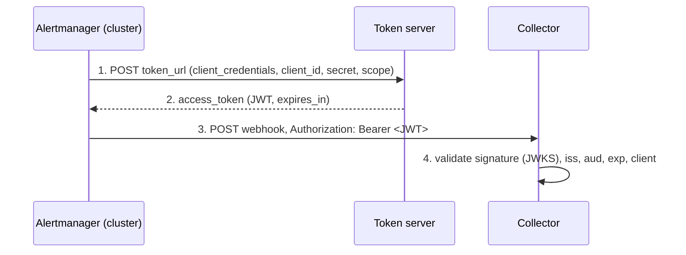

# Alertmanager on OpenShift: OAuth2-authenticated webhook

## 1. Context and principle

The Alertmanager embedded in OpenShift natively authenticates to a webhook
receiver with OAuth2 `client_credentials`: no third-party component is needed
if the token server follows this standard flow.

Today each cluster sends its alerts as unauthenticated HTTP(S) POSTs. Target:
each cluster gets a token from the token server, then presents it to the
collector in the `Authorization: Bearer <token>` header.

How Alertmanager handles it:

1. On the first send, Alertmanager calls `token_url` with its `client_id` /
   `client_secret` (grant `client_credentials`, optional scopes and parameters).
2. It caches the token and reuses it until expiry, then renews it by itself.
3. Every webhook notification carries the token as `Bearer`.
4. The collector validates the token (JWKS signature or introspection), then
   processes the payload, unchanged from today.



Steps 1 and 2 only happen when the token expires; only step 3 repeats on every
notification.

Two places can carry the OAuth2 configuration:

| | Platform Alertmanager (Secret `alertmanager-main`) | Per-namespace `AlertmanagerConfig` (CRD) |
|---|---|---|
| Scope | All cluster alerts, platform included | Alerts of a single namespace (`namespace` matcher enforced) |
| Format | Raw `alertmanager.yaml`, snake_case | Kubernetes resource, camelCase |
| Secrets | Files mounted via `cluster-monitoring-config` | References to Secrets in the namespace |
| Use case | Central monitoring integration (ours, section 3) | Application teams, per-project GitOps (section 4) |

Switch OpenShift Alertmanager notifications from an unauthenticated webhook to
an authenticated one, using a token server and the OAuth2 `client_credentials`
flow. This repo holds:

- the reference procedure (sections 1, 2 and 4 to 7),
- a lab that validates it end to end on any OpenShift cluster (section 3):
  Keycloak as token server, a webhook receiver that really validates the JWT,
  and the platform Alertmanager configuration.

Lab for OpenShift 4.18+ (Keycloak 26.4).

```text
.
├── lab/                         # oc apply -k lab/
│   ├── kustomization.yaml
│   ├── namespace.yaml           # am-oauth2-lab
│   ├── keycloak.yaml            # token server, HTTPS via service CA
│   ├── keycloak/realm-monitoring.json
│   ├── receiver.yaml            # JWT-validating receiver (Hummingbird images)
│   └── receiver/                # app.py, requirements.txt, optional Containerfile
├── platform-alertmanager/
│   └── cluster-monitoring-config.yaml   # only for clusters without this ConfigMap
└── tests/token_tests.py         # token endpoint + receiver checks, run in a pod
```

Tools: `oc` logged in as `cluster-admin`, `jq`, `openssl`, a text editor.

---

## 2. Prerequisites

Gather these before any cluster change. Any unchecked item blocks the switch.

**Token server**

- [ ] `client_credentials` flow (RFC 6749 §4.4) available. Not natively
      supported: password grant, `private_key_jwt`, mTLS to the IdP, non-standard
      responses. Those need a relay.
- [ ] One OAuth2 client per cluster (recommended: traceability, per-cluster
      revocation) or a shared client.
- [ ] Exact token endpoint URL (Keycloak:
      `https://<idp>/realms/<realm>/protocol/openid-connect/token`).
- [ ] Scopes and/or `audience` expected by the collector.
- [ ] Token lifetime known (5 to 60 min is common; renewal is automatic).

**Collector (webhook receiver)**

- [ ] Bearer token validation enabled, with a grace period that still accepts
      the old mode during the switch.
- [ ] Authorization rule: which `client_id` / claims are accepted.

**Network and PKI**

- [ ] Egress open from the nodes hosting `alertmanager-main-*` to the token
      endpoint (443) and the collector.
- [ ] Outbound proxy if any: declare it explicitly in the receiver config,
      `oauth2.proxy_url` for the token endpoint and `http_config.proxy_url`
      for the collector (the cluster proxy is not applied implicitly).
- [ ] CAs that issued the token endpoint and collector certificates, in PEM.

**OpenShift**

- [ ] OCP version of each cluster (`oc get clusterversion`). `oauth2` is
      supported since OCP 4.8.
- [ ] `cluster-admin` (platform Alertmanager) or `alert-routing-edit` on the
      namespace (`AlertmanagerConfig`).
- [ ] Backup of the current config (3.3).

---

## 3. Lab: build and test

Lab components, all in namespace `am-oauth2-lab`:

| Component | Image | Role |
|---|---|---|
| `keycloak` | `quay.io/keycloak/keycloak:26.4` (no Hummingbird image exists) | Token server, `start-dev`, HTTPS with a service CA certificate. Realm `monitoring`, token lifetime 300 s |
| `webhook-receiver` | `quay.io/hummingbird/python:3.13` (distroless) + `3.13-builder` init container | Validates the JWT against Keycloak JWKS, logs payload + `client_id` |

Realm `monitoring` (imported from `lab/keycloak/realm-monitoring.json`):

- client scope `alerting`, with an audience mapper adding `aud: alert-collector`;
- client `ocp-allowed`: confidential, service account only (`client_credentials`),
  optional scope `alerting`, listed in the receiver's `ALLOWED_CLIENTS`. This is
  the client Alertmanager uses: its notifications are accepted (200);
- client `ocp-not-allowed`: identical at the IdP (it gets a valid token), but
  absent from `ALLOWED_CLIENTS`, so the receiver rejects it (403). Proves the
  collector checks which client is calling, not only that the token is valid.

The receiver (`lab/receiver/app.py`, standard library + PyJWT) accepts a request
on `/alerts` only if the token has a valid RS256 signature (JWKS), `iss` =
`https://keycloak.am-oauth2-lab.svc:8443/realms/monitoring`,
`aud` = `alert-collector`, a valid `exp`, scope `alerting`, and
`azp` (client ID) in `ALLOWED_CLIENTS`. `/alerts-legacy` accepts anything and
plays the current unauthenticated flow. The internal image registry is not
needed: the init container installs PyJWT from PyPI at pod start.

All commands run from the repo root, logged in as `cluster-admin`.

### 3.1 Deploy the token server and the receiver

```bash
oc apply -f lab/namespace.yaml

# Client secrets, generated once (Keycloak substitutes them into the realm import)
oc -n am-oauth2-lab get secret keycloak-lab >/dev/null 2>&1 || \
oc -n am-oauth2-lab create secret generic keycloak-lab \
  --from-literal=admin-password="$(openssl rand -hex 12)" \
  --from-literal=ocp-allowed-client-secret="$(openssl rand -hex 24)" \
  --from-literal=ocp-not-allowed-client-secret="$(openssl rand -hex 24)"

oc apply -k lab/
oc -n am-oauth2-lab rollout status deploy/keycloak --timeout=300s
oc -n am-oauth2-lab rollout status deploy/webhook-receiver --timeout=180s
oc -n am-oauth2-lab logs deploy/keycloak | grep -E "Realm 'monitoring' imported|started in"
```

Keycloak keeps its data in the container (H2, dev mode): a pod restart
re-imports the realm from the ConfigMap and the Secret.

### 3.2 Test the token endpoint and the receiver from the cluster

Runs `tests/token_tests.py` in a throwaway pod in `openshift-monitoring` (same
network path as Alertmanager). Secrets go through stdin, never into the pod spec.

```bash
{
  echo "S_ALLOWED = '$(oc -n am-oauth2-lab get secret keycloak-lab -o jsonpath='{.data.ocp-allowed-client-secret}' | base64 -d)'"
  echo "S_NOT_ALLOWED = '$(oc -n am-oauth2-lab get secret keycloak-lab -o jsonpath='{.data.ocp-not-allowed-client-secret}' | base64 -d)'"
  cat tests/token_tests.py
} | oc -n openshift-monitoring run token-tests --rm -i --quiet --restart=Never \
      --image=quay.io/hummingbird/python:3.13 --command -- python3 -
```

Expected output:

```text
== Token endpoint: https://keycloak.am-oauth2-lab.svc:8443/realms/monitoring/protocol/openid-connect/token
OK  ocp-allowed token, credentials in body (client_secret_post) (expected HTTP 200, got HTTP 200)
    response: {"expires_in": 300, "refresh_expires_in": 0, "token_type": "Bearer", "not-before-policy": 0, "scope": "alerting"}
    claims:   {"iss": "https://keycloak.am-oauth2-lab.svc:8443/realms/monitoring", "aud": "alert-collector", "azp": "ocp-allowed", "client_id": null, "scope": "alerting", ...}
OK  ocp-allowed token, credentials in Basic Auth (client_secret_basic) (expected HTTP 200, got HTTP 200)
OK  ocp-allowed token, wrong secret (expected HTTP 401, got HTTP 401)
== Receiver: https://webhook-receiver.am-oauth2-lab.svc:8443
OK  /alerts with valid token (expected HTTP 200, got HTTP 200)
OK  /alerts without token (expected HTTP 401, got HTTP 401)
OK  /alerts with forged token (expected HTTP 401, got HTTP 401)
OK  /alerts token without alerting scope (no audience) (expected HTTP 401, got HTTP 401)
OK  /alerts token from a client not allowed (ocp-not-allowed) (expected HTTP 403, got HTTP 403)
OK  /alerts-legacy without token (legacy flow) (expected HTTP 200, got HTTP 200)
== Result: 9 OK, 0 KO
```

Keycloak accepts both client authentication methods; Alertmanager's Go OAuth2
library picks the one the IdP accepts. The client ID is in `azp` (no
`client_id` claim, because the realm only defines the `alerting` scope).

Equivalent single check with curl (Hummingbird curl image; the secret is
visible in the pod spec while it runs):

```bash
oc -n openshift-monitoring run tok-test --rm -i --quiet --restart=Never \
  --image=quay.io/hummingbird/curl:8 -- \
  -sS --cacert /var/run/secrets/kubernetes.io/serviceaccount/service-ca.crt -X POST \
  -d grant_type=client_credentials -d client_id=ocp-allowed \
  -d client_secret="$(oc -n am-oauth2-lab get secret keycloak-lab -o jsonpath='{.data.ocp-allowed-client-secret}' | base64 -d)" \
  -d scope=alerting \
  https://keycloak.am-oauth2-lab.svc:8443/realms/monitoring/protocol/openid-connect/token
```

A `couldn't attach to pod ... falling back to streaming logs` warning is
harmless: curl finishes before `oc` attaches, the output still comes through.

### 3.3 Back up the platform monitoring config

```bash
mkdir -p platform-alertmanager/backup

oc -n openshift-monitoring get secret alertmanager-main \
  --template='{{ index .data "alertmanager.yaml" }}' | base64 -d \
  > platform-alertmanager/backup/alertmanager.yaml

oc -n openshift-monitoring get configmap cluster-monitoring-config \
  -o jsonpath='{.data.config\.yaml}' \
  > platform-alertmanager/backup/cluster-monitoring-config.yaml
```

If the last command answers `NotFound`, the cluster has no
`cluster-monitoring-config` ConfigMap yet. Note it: it changes step 3.5 and the
rollback (3.11).

### 3.4 Create the OAuth2 credentials Secret

Holds the `ocp-allowed` client secret and the CA. In the lab the CA is the
OpenShift service CA (it signed both the Keycloak and the receiver
certificates).

```bash
oc -n openshift-monitoring create secret generic am-oauth2 \
  --from-literal=client-secret="$(oc -n am-oauth2-lab get secret keycloak-lab -o jsonpath='{.data.ocp-allowed-client-secret}' | base64 -d)" \
  --from-literal=ca.crt="$(oc -n am-oauth2-lab get configmap openshift-service-ca.crt -o jsonpath='{.data.service-ca\.crt}')"
```

### 3.5 Mount the Secret in the Alertmanager pods

The monitoring operator mounts the Secrets listed in
`alertmanagerMain.secrets` of the `cluster-monitoring-config` ConfigMap.

**The ConfigMap does not exist** (`NotFound` in 3.3): create it.

```bash
oc apply -f platform-alertmanager/cluster-monitoring-config.yaml
```

**The ConfigMap exists**: edit it and add the `alertmanagerMain.secrets` entry,
keeping every existing setting.

```bash
oc -n openshift-monitoring edit configmap cluster-monitoring-config
```

Add the three lines marked `# add` under `config.yaml: |` (the other lines are
examples of existing settings, keep yours as they are):

```yaml
data:
  config.yaml: |
    enableUserWorkload: true      # existing setting, keep
    alertmanagerMain:             # add
      secrets:                    # add
        - am-oauth2               # add
```

If `alertmanagerMain:` is already there, add only `secrets:` under it; if
`secrets:` is already there, add only `- am-oauth2` to the list.

Then wait for the operator to restart the Alertmanager pods and check the mount:

```bash
sleep 30
oc -n openshift-monitoring rollout status statefulset/alertmanager-main --timeout=300s
oc -n openshift-monitoring exec alertmanager-main-0 -c alertmanager -- \
  ls /etc/alertmanager/secrets/am-oauth2/
# expected: ca.crt  client-secret
```

### 3.6 Add the OAuth2 receiver to the Alertmanager config

Start from a copy of the backup:

```bash
cp platform-alertmanager/backup/alertmanager.yaml platform-alertmanager/alertmanager.yaml
```

On a cluster with the default OpenShift config, the copy contains exactly this
(the operator writes every key in quotes):

```yaml
"global":
  "http_config":
    "proxy_from_environment": true
"inhibit_rules":
- "equal":
  - "namespace"
  - "alertname"
  "source_matchers":
  - "severity = critical"
  "target_matchers":
  - "severity =~ warning|info"
- "equal":
  - "namespace"
  - "alertname"
  "source_matchers":
  - "severity = warning"
  "target_matchers":
  - "severity = info"
"receivers":
- "name": "Default"
- "name": "Watchdog"
- "name": "Critical"
"route":
  "group_by":
  - "namespace"
  "group_interval": "5m"
  "group_wait": "30s"
  "receiver": "Default"
  "repeat_interval": "12h"
  "routes":
  - "matchers":
    - "alertname = Watchdog"
    "receiver": "Watchdog"
  - "matchers":
    - "severity = critical"
    "receiver": "Critical"
```

Edit `platform-alertmanager/alertmanager.yaml` so it becomes the file below.
Nothing is removed; two blocks are added, between the `ADD` comment lines:

- **ADD 1**, two receivers, at the end of the `"receivers"` list (after
  `"Critical"`, before `"route":`), at column 0 like the existing entries;
- **ADD 2**, two routes, at the top of the `"routes"` list (right after
  `"routes":`, before the `Watchdog` route), indented 2 spaces like the
  existing entries. First position plus `continue: true` means both receivers
  get every alert, `Watchdog` included, and the existing routes still apply.

```yaml
"global":
  "http_config":
    "proxy_from_environment": true
"inhibit_rules":
- "equal":
  - "namespace"
  - "alertname"
  "source_matchers":
  - "severity = critical"
  "target_matchers":
  - "severity =~ warning|info"
- "equal":
  - "namespace"
  - "alertname"
  "source_matchers":
  - "severity = warning"
  "target_matchers":
  - "severity = info"
"receivers":
- "name": "Default"
- "name": "Watchdog"
- "name": "Critical"
# ---------- ADD 1: lab receivers (begin) ----------
- name: monitoring-legacy             # unauthenticated, plays today's flow
  webhook_configs:
    - url: https://webhook-receiver.am-oauth2-lab.svc:8443/alerts-legacy
      send_resolved: true
      http_config:
        tls_config:
          ca_file: /etc/alertmanager/secrets/am-oauth2/ca.crt
- name: monitoring-oauth2             # OAuth2 client_credentials
  webhook_configs:
    - url: https://webhook-receiver.am-oauth2-lab.svc:8443/alerts
      send_resolved: true
      max_alerts: 0
      http_config:
        oauth2:
          client_id: ocp-allowed
          client_secret_file: /etc/alertmanager/secrets/am-oauth2/client-secret
          token_url: https://keycloak.am-oauth2-lab.svc:8443/realms/monitoring/protocol/openid-connect/token
          scopes: [alerting]
          # TLS for the call to the token endpoint
          tls_config:
            ca_file: /etc/alertmanager/secrets/am-oauth2/ca.crt
        # TLS for the call to the receiver (independent from the one above)
        tls_config:
          ca_file: /etc/alertmanager/secrets/am-oauth2/ca.crt
# ---------- ADD 1: lab receivers (end) ----------
"route":
  "group_by":
  - "namespace"
  "group_interval": "5m"
  "group_wait": "30s"
  "receiver": "Default"
  "repeat_interval": "12h"
  "routes":
  # ---------- ADD 2: lab routes (begin) ----------
  - receiver: monitoring-oauth2
    group_wait: 10s
    continue: true
  - receiver: monitoring-legacy
    group_wait: 10s
    continue: true
  # ---------- ADD 2: lab routes (end) ----------
  - "matchers":
    - "alertname = Watchdog"
    "receiver": "Watchdog"
  - "matchers":
    - "severity = critical"
    "receiver": "Critical"
```

The added lines use plain keys; they mix fine with the operator's quoted keys.
If your cluster's config is not the default, add the same two blocks at the
same places in your own file: each added `-` lines up with the `-` of the
entries already in that list.

Validate the file with the cluster's own `amtool` before applying:

```bash
oc -n openshift-monitoring exec -i alertmanager-main-0 -c alertmanager -- \
  amtool check-config /dev/stdin < platform-alertmanager/alertmanager.yaml
# expected: SUCCESS, with 2 more receivers than before
```

### 3.7 Apply the Alertmanager config

```bash
oc -n openshift-monitoring create secret generic alertmanager-main \
  --from-file=alertmanager.yaml=platform-alertmanager/alertmanager.yaml --dry-run=client -o yaml \
  | oc -n openshift-monitoring replace secret --filename=-
```

The reload sidecar picks it up within one to two minutes, no restart. Check:

```bash
# Loaded by the running process (secrets are masked)
oc -n openshift-monitoring exec alertmanager-main-0 -c alertmanager -- \
  amtool config show --alertmanager.url=http://localhost:9093 | grep -A12 'name: monitoring-oauth2'

# Config generated by the operator is valid
oc -n openshift-monitoring exec alertmanager-main-0 -c alertmanager -- \
  amtool check-config /etc/alertmanager/config_out/alertmanager.env.yaml

oc -n openshift-monitoring logs alertmanager-main-0 -c alertmanager --since=5m \
  | grep -Ei 'config|oauth|error'
```

`Completed loading of configuration file` confirms the load.
`Loading configuration file failed` means the previous config is still active.

### 3.8 Send a test alert and check the receiver

```bash
oc -n openshift-monitoring exec alertmanager-main-0 -c alertmanager -- \
  amtool alert add TestOAuth2 severity=info cluster=lab \
  --annotation='summary="OAuth2 integration test"' \
  --alertmanager.url=http://localhost:9093

sleep 20
oc -n am-oauth2-lab logs deploy/webhook-receiver | grep TestOAuth2
```

Expected: one line per endpoint, the authenticated one with
`"endpoint": "/alerts", "outcome": "accepted", "client_id": "ocp-allowed"`,
`"auth_status": 200` and the token `jti` / `exp`, and one on `/alerts-legacy`.
Already active alerts (`Watchdog`, ...) also show up after the reload: Watchdog
is the permanent witness that the flow works.

Full view (counters + last 100 events):

```bash
oc -n am-oauth2-lab exec deploy/webhook-receiver -- python3 -c \
  "import ssl,urllib.request;print(urllib.request.urlopen('https://localhost:8443/stats',context=ssl._create_unverified_context()).read().decode())" \
  | jq '.counters'
```

### 3.9 Metrics

```bash
for q in 'alertmanager_notifications_total{integration="webhook"}' \
         'alertmanager_notifications_failed_total{integration="webhook"}'; do
  oc -n openshift-monitoring exec prometheus-k8s-0 -c prometheus -- \
    curl -s http://localhost:9090/api/v1/query --data-urlencode "query=$q" \
    | jq -r '.data.result[] | "\(.metric.__name__) \(.metric.pod) \(.value[1])"'
done
```

Expected: `notifications_total` growing, `notifications_failed_total` at 0. In
Alertmanager 0.33 these metrics carry `integration` but no receiver label, so
legacy and OAuth2 webhooks are summed together.

### 3.10 Experiments

**Token renewal.** Token lifetime is 300 s. Send another alert (3.8, change
the alert name) after 5 minutes: the `auth.jti` in the receiver log changes,
with no error in Alertmanager.

**Wrong client secret.** Break the secret, wait for the kubelet sync (1 to
2 min) and the cached token expiry (up to 5 min), send an alert:

```bash
oc -n openshift-monitoring create secret generic am-oauth2 \
  --from-literal=client-secret=wrong \
  --from-literal=ca.crt="$(oc -n am-oauth2-lab get configmap openshift-service-ca.crt -o jsonpath='{.data.service-ca\.crt}')" \
  --dry-run=client -o yaml | oc -n openshift-monitoring replace -f -
# expected in alertmanager logs: oauth2: "invalid_client" ... 401, failed counter > 0
```

Restore the right secret:

```bash
oc -n openshift-monitoring create secret generic am-oauth2 \
  --from-literal=client-secret="$(oc -n am-oauth2-lab get secret keycloak-lab -o jsonpath='{.data.ocp-allowed-client-secret}' | base64 -d)" \
  --from-literal=ca.crt="$(oc -n am-oauth2-lab get configmap openshift-service-ca.crt -o jsonpath='{.data.service-ca\.crt}')" \
  --dry-run=client -o yaml | oc -n openshift-monitoring replace -f -
```

**Tolerant collector (migration mode).**

```bash
oc -n am-oauth2-lab set env deploy/webhook-receiver AUTH_MODE=tolerant
# Rerun 3.2: the 401/403 checks now return 200 (KO in the test output, by design);
# receiver logs show "outcome": "tolerated". Back to strict:
oc -n am-oauth2-lab set env deploy/webhook-receiver AUTH_MODE=strict
```

**Cut-over.** Remove the `monitoring-legacy` route and receiver from
`platform-alertmanager/alertmanager.yaml`, validate and apply again (end of 3.6,
then 3.7): only `/alerts` keeps receiving.

### 3.11 Rollback and cleanup

1. Restore the original Alertmanager config (it no longer references the
   mounted files):

   ```bash
   oc -n openshift-monitoring create secret generic alertmanager-main \
     --from-file=alertmanager.yaml=platform-alertmanager/backup/alertmanager.yaml --dry-run=client -o yaml \
     | oc -n openshift-monitoring replace secret --filename=-
   ```

2. Restore the monitoring config, which unmounts `am-oauth2`.

   If the ConfigMap existed before the lab:

   ```bash
   oc -n openshift-monitoring create configmap cluster-monitoring-config \
     --from-file=config.yaml=platform-alertmanager/backup/cluster-monitoring-config.yaml --dry-run=client -o yaml \
     | oc -n openshift-monitoring replace -f -
   ```

   If it did not exist (`NotFound` in 3.3):

   ```bash
   oc -n openshift-monitoring delete configmap cluster-monitoring-config
   ```

3. Wait for the Alertmanager pods to restart, then delete the lab resources and
   the working files:

   ```bash
   sleep 30
   oc -n openshift-monitoring rollout status statefulset/alertmanager-main --timeout=300s
   oc -n openshift-monitoring delete secret am-oauth2
   oc delete namespace am-oauth2-lab
   rm -r platform-alertmanager/backup platform-alertmanager/alertmanager.yaml
   ```

---

## 4. Per Namespace alternative

Declarative and GitOps-native, but it only sees alerts from the namespace where
the resource lives: the operator always injects a `namespace="<ns>"` matcher.
It does not replace the platform Alertmanager configuration (section 3) for
platform alerts.

### 4.1 Enable `AlertmanagerConfig` support

Two options.

**Option 1: routing through the platform Alertmanager** (no dedicated
Alertmanager for user projects)

```yaml
# ConfigMap cluster-monitoring-config, namespace openshift-monitoring
data:
  config.yaml: |
    enableUserWorkload: true
    alertmanagerMain:
      enableUserAlertmanagerConfig: true
```

**Option 2: dedicated Alertmanager for user projects**

```yaml
# ConfigMap user-workload-monitoring-config, namespace openshift-user-workload-monitoring
data:
  config.yaml: |
    alertmanager:
      enabled: true
      enableAlertmanagerConfig: true
```

Namespaces `openshift-*` and those labeled `openshift.io/user-monitoring=false`
are excluded.

### 4.2 Permissions

The team managing the namespace needs the `alert-routing-edit` role:

```bash
oc -n <namespace> adm policy add-role-to-user alert-routing-edit <user-or-group>
```

### 4.3 Create the Secret in the namespace

```bash
oc -n <namespace> create secret generic am-oauth2 \
  --from-literal=client-id='ocp-<cluster-name>-<namespace>' \
  --from-literal=client-secret='<CLIENT_SECRET>' \
  --from-file=ca.crt=./ca-idp-and-collector.pem
```

### 4.4 Create the `AlertmanagerConfig`

```yaml
apiVersion: monitoring.coreos.com/v1beta1
kind: AlertmanagerConfig
metadata:
  name: monitoring-oauth2
  namespace: <namespace>
spec:
  route:
    receiver: monitoring-oauth2
    groupBy: [alertname]
    groupWait: 30s
    groupInterval: 5m
    repeatInterval: 4h
  receivers:
    - name: monitoring-oauth2
      webhookConfigs:
        - url: https://collector.example.com/alerts
          sendResolved: true
          httpConfig:
            oauth2:
              clientId:
                secret:
                  name: am-oauth2
                  key: client-id
              clientSecret:
                name: am-oauth2
                key: client-secret
              tokenUrl: https://idp.example.com/realms/monitoring/protocol/openid-connect/token
              scopes: [alerting]
              # endpointParams:
              #   audience: alert-collector
            tlsConfig:
              ca:
                secret:
                  name: am-oauth2
                  key: ca.crt
```

```bash
oc apply -f monitoring-oauth2.yaml
```

The fields available under `oauth2` (notably `tlsConfig` and `proxyUrl` for the
token endpoint) depend on the embedded operator version. Check on each OCP
version:

```bash
oc explain alertmanagerconfig.spec.receivers.webhookConfigs.httpConfig.oauth2 \
  --api-version=monitoring.coreos.com/v1beta1
```

### 4.5 Check the generated config

The operator merges the resource into the generated config. An invalid
`AlertmanagerConfig` is silently ignored for routing: check it.

```bash
# Config actually generated (platform Alertmanager, option 1)
oc -n openshift-monitoring exec alertmanager-main-0 -c alertmanager -- \
  cat /etc/alertmanager/config_out/alertmanager.env.yaml | grep -A15 monitoring-oauth2

# Reconciliation errors
oc -n openshift-monitoring logs deploy/prometheus-operator | grep -i alertmanagerconfig
```

For option 2, use `openshift-user-workload-monitoring`, pod
`alertmanager-user-workload-0` and the `prometheus-operator` deployment of that
namespace.

## 5. User Workload Monitoring

An OpenShift cluster can run two Alertmanagers:

- the **platform Alertmanager** (`alertmanager-main` in `openshift-monitoring`):
  always present, configured in section 3;
- an optional **user workload Alertmanager** (`alertmanager-user-workload` in
  `openshift-user-workload-monitoring`): only present if an administrator
  enabled it (`alertmanager.enabled: true` in `user-workload-monitoring-config`).

When the second one exists, alerts from user projects (application alerts) go
through it instead of the platform Alertmanager. It has its own configuration,
so section 3 does not cover it: if it also sends to the collector, it must be
switched to OAuth2 too, or application alerts stay unauthenticated.

Check whether it exists:

```bash
oc -n openshift-user-workload-monitoring get pods -l app.kubernetes.io/name=alertmanager
```

- `No resources found`: nothing to do, every alert goes through the platform
  Alertmanager.
- `alertmanager-user-workload-0` is listed: repeat steps 3.3 to 3.7 for it,
  with these substitutions:

| Item | Platform | User Workload |
|---|---|---|
| Namespace | `openshift-monitoring` | `openshift-user-workload-monitoring` |
| Config Secret | `alertmanager-main` | `alertmanager-user-workload` |
| Mount ConfigMap | `cluster-monitoring-config` → `alertmanagerMain.secrets` | `user-workload-monitoring-config` → `alertmanager.secrets` |
| Pod | `alertmanager-main-0` | `alertmanager-user-workload-0` |

Recommendation: use a distinct `client_id` (for example `ocp-<cluster>-uwm`) to
tell the flows apart on the collector side.

## 6. Validation and tests

Validate in this order: the token can be obtained from the cluster, the config
is loaded, a test alert reaches the collector authenticated.

### 6.1 Test the token endpoint from the cluster

Before touching Alertmanager, from a throwaway pod on the same network:

```bash
oc -n openshift-monitoring run tok-test --rm -i --restart=Never \
  --image=quay.io/hummingbird/curl:8 -- \
  -sS --cacert /path/to/ca.pem -X POST \
  -d grant_type=client_credentials \
  -d client_id=ocp-<cluster-name> \
  -d client_secret='<CLIENT_SECRET>' \
  -d scope=alerting \
  https://idp.example.com/realms/monitoring/protocol/openid-connect/token
```

Expected: JSON with `access_token`, `token_type: Bearer`, `expires_in`.
Alertmanager's Go OAuth2 library detects by itself whether the IdP expects
credentials in Basic Auth or in the body; testing the `-u client_id:client_secret`
variant clears any doubt on failure. (The lab's `tests/token_tests.py` checks
both.)

### 6.2 Check the loaded config

```bash
oc -n openshift-monitoring exec alertmanager-main-0 -c alertmanager -- \
  amtool check-config /etc/alertmanager/config_out/alertmanager.env.yaml
```

### 6.3 Send a test alert

```bash
oc -n openshift-monitoring exec alertmanager-main-0 -c alertmanager -- \
  amtool alert add TestOAuth2 severity=info cluster=<cluster-name> \
  --annotation='summary="OAuth2 integration test"' \
  --alertmanager.url=http://localhost:9093
```

The `Watchdog` alert, always firing, is also a permanent witness: receiving it
regularly proves the flow works.

### 6.4 Indicators to watch

| Check | Command / query | Expected |
|---|---|---|
| Webhook send failures | `rate(alertmanager_notifications_failed_total{integration="webhook"}[5m])` | 0 |
| Volume sent | `rate(alertmanager_notifications_total{integration="webhook"}[5m])` | > 0 |
| Alertmanager logs | `oc logs alertmanager-main-0 -c alertmanager \| grep -i notify` | No `401`, `403`, `oauth2` |
| Collector side | Access logs | Authenticated requests, expected `client_id` |

Run PromQL queries from the console: Observe → Metrics. Add a dedicated alert on
the first indicator, routed to a channel that does not depend on the webhook.

## 7. Switch, rollback, rotation and troubleshooting

### 7.1 Per-cluster switch plan

1. Collector: enable token validation in tolerant mode (accepts with or
   without token, logs).
2. Pilot cluster (non-production): deploy the OAuth2 receiver **in parallel**
   with the legacy one (3.6).
3. Validate (section 6) for 24 to 48 h: alerts received twice, no errors.
4. Remove the legacy receiver from `alertmanager.yaml` and reapply.
5. Extend to the other clusters in waves.
6. Once every cluster is switched: collector in strict mode (rejects requests
   without a valid token), old URL closed.

### 7.2 Rollback

Reapply the backup taken in 3.3; no restart needed (full lab rollback: 3.11).

```bash
oc -n openshift-monitoring create secret generic alertmanager-main \
  --from-file=alertmanager.yaml=platform-alertmanager/backup/alertmanager.yaml --dry-run=client -o yaml \
  | oc -n openshift-monitoring replace secret --filename=-
```

Per-namespace `AlertmanagerConfig`:
`oc delete alertmanagerconfig monitoring-oauth2 -n <namespace>`.

### 7.3 Client secret rotation

1. Generate a new secret on the IdP, keeping the old one valid (if the IdP
   allows it).
2. Update the Kubernetes Secret:

   ```bash
   oc -n openshift-monitoring create secret generic am-oauth2 \
     --from-literal=client-secret='<NEW_SECRET>' \
     --from-file=ca.crt=./ca-idp-and-collector.pem \
     --dry-run=client -o yaml | oc -n openshift-monitoring replace -f -
   ```

3. The kubelet updates the mounted file within one to two minutes; the new
   secret is used at the next token renewal. When in doubt, delete the pods one
   at a time (`oc delete pod alertmanager-main-0`, wait, then `-1`).
4. Check sends (6.4), then revoke the old secret on the IdP.

For an `AlertmanagerConfig`, rotate the Secret in the namespace; the operator regenerates
the config automatically.

### 7.4 Troubleshooting

| Symptom | Likely cause | Action |
|---|---|---|
| `oauth2: cannot fetch token` + `401` / `invalid_client` | Wrong `client_id` / secret, or credential method refused | Replay test 6.1; check the mounted file content |
| `x509: certificate signed by unknown authority` | Missing CA for the token endpoint or the collector | Check `oauth2.tls_config` **and** `http_config.tls_config` |
| Timeout to the token endpoint | Network flow closed or undeclared proxy | Test from a pod; add `oauth2.proxy_url` |
| Token obtained but `401` / `403` from the collector | Scope, audience or claim not accepted | Compare the decoded JWT with collector expectations; add `endpoint_params.audience` |
| Config not applied | Invalid YAML, old config kept | `alertmanager` logs: `Loading configuration file failed`; `amtool check-config` |
| `no such file` on `client_secret_file` | Secret not listed in `alertmanagerMain.secrets` | Fix `cluster-monitoring-config`, wait for the pod restart |
| `AlertmanagerConfig` has no effect | Feature not enabled, namespace excluded, or resource rejected | 4.1; `prometheus-operator` logs |
| Platform alerts missing with `AlertmanagerConfig` | Expected: `namespace` matcher enforced | Use the platform Alertmanager (section 3) for platform alerts |

## Sources

- [Red Hat, AlertmanagerConfig v1beta1 (OCP 4.20)](https://docs.redhat.com/en/documentation/openshift_container_platform/4.20/html/monitoring_apis/alertmanagerconfig-monitoring-coreos-com-v1beta1#spec-receivers-webhookconfigs-httpconfig-oauth2)
- [Alertmanager configuration schema, oauth2 block](https://www.schemastore.org/prometheus-alertmanager.json)
- [Project Hummingbird images](https://quay.io/organization/hummingbird)
